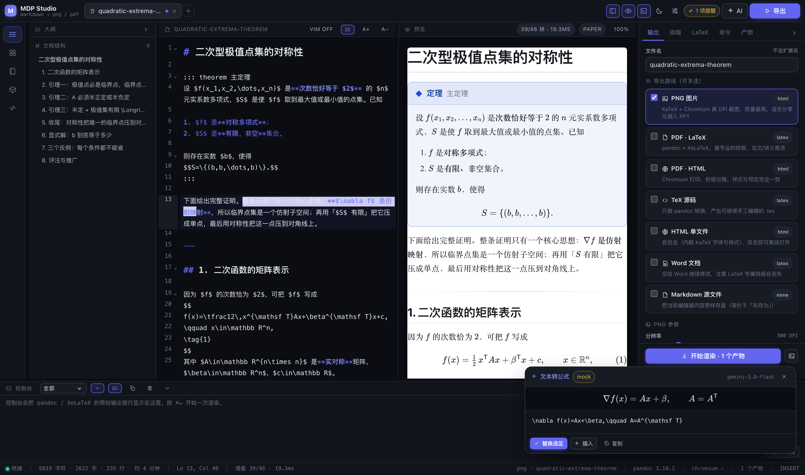

# MDP Studio —— Markdown → PNG / TeX-PDF，终端与浏览器双模

把「在终端里敲一条命令出一张高清公式图」和「在网页里所见即所得地排版导出」
做成**同一个引擎**：预览、PNG、HTML、PDF 共用一份 Markdown 渲染器与一份排版
样式表，因此不存在"预览好看、导出走样"的问题。

```sh
mdp serve                      # 启动网页工作台（自动打开浏览器）
mdp build 定理.md -t png --dpi 300 --card    # 不开网页，直接出高清图
mdp build 论文.md -t pdf -q cn --toc         # 中文论文 PDF（ctex）
mdp doctor                     # 环境体检：pandoc / LaTeX / Chromium / 栅格化器
```

---

## 0. 30 秒上手

```sh
cd /Users/fubin/scripts

npm install          # 只装前端构建依赖；后台运行时零依赖
npm run build        # 产出 web/dist
npm run verify       # 端到端自检（会真的渲染 PNG/PDF/HTML 各一遍）

./install.sh         # 建软链：~/.local/bin/{md2pdf,m2p,mdp}
mdp serve            # 打开 http://127.0.0.1:8757
```



**想找什么，去哪一节：**

| 你要找的 | 去哪 |
|:--|:--|
| 每项能力**从哪调用、实现在哪一行** | [§6.1 调用与实现索引](#61-调用与实现索引) |
| 面向使用者的完整说明（可导出 PDF） | [`docs/manual.md`](docs/manual.md) → `manual.pdf` / `manual.docx` |
| 想加/改一个功能，该动哪个文件 | [§9 扩展方式](#9-扩展方式) |
| 命令行参数全集 | `mdp help <命令> --all`，或 [§10 原有 md2pdf 参考](#10-原有-md2pdf-参考) |
| 出问题了 | `mdp doctor`，或 [§8 自检与故障排查](#8-自检与故障排查) |
| 实测数据与已知缺陷 | [`docs/technical-report.md`](docs/technical-report.md) |
| 核心实现怎么写的 | [`docs/core-walkthrough.md`](docs/core-walkthrough.md) |

---

## 1. 设计取舍：为什么是这套架构

需求是"网页可视化 + 保留终端操作 + 复用已有脚本"。落到三个决定：

| 决定 | 理由 |
|:--|:--|
| **后台：Node 零运行时依赖** | 后台是常驻进程。除 `pandoc`/`xelatex`/`chromium` 这些外部命令外，服务本身不 import 任何第三方包——`npm` 装坏了也照样能渲染。SSE 用 `node:http`，CDP 用 Node ≥20 内置的全局 `WebSocket`。 |
| **PNG 走 HTML+Chromium，PDF 走 LaTeX** | 这是两条**各自最优**的路线，而不是二选一。Chromium 的 `deviceScaleFactor` 给出**真 DPI** 截图（300 DPI 就是 300 DPI），KaTeX 的排版质量接近 LaTeX；而打印级排版、ctex 中文、参考文献仍然交给 `pandoc + XeLaTeX`。两条路线共用同一份渲染语义。 |
| **不重写 md2pdf，而是扩展它** | 现有的 `md2pdf` 已经沉淀了 7 个质量档位、中文 ctex 排版、字体探测、增量缓存。后台通过 `md2pdf list --json` **读取**档位定义（单一事实来源），通过 `md2pdf -q <档位> …` **调用**渲染，一行档位逻辑都没有复制。 |

因此本项目里没有任何"两套实现需要手动保持一致"的地方：

```
                   ┌──────────────────────────────┐
                   │   shared/markdown.mjs        │  Markdown + KaTeX + 代码高亮 + 容器
                   │   shared/theme.mjs           │  文档样式表（含 @page / 打印规则）
                   └───────────────┬──────────────┘
             ┌─────────────────────┼─────────────────────┐
             ▼                     ▼                     ▼
      浏览器实时预览         Chromium 导出          md2pdf (pandoc+XeLaTeX)
      （同一份 HTML/CSS）   PNG / PDF / HTML        PDF / TeX / DOCX
```

---

## 2. 网页工作台

```sh
mdp serve [--port 8757] [--host 127.0.0.1] [--no-open] [--concurrency 2] [--token 口令]
```

只监听回环地址（它会执行本地命令，不应对外暴露）；`--token` 可再加一层口令。
端口被占用时自动向后找可用端口。

### 界面

| 区域 | 能力 |
|:--|:--|
| **标签页** | 多文档、双击重命名、`+` 新建、拖入 `.md` 导入、`⌘⇧N` |
| **左侧栏** | 大纲（点击定位）· 模板（定理/证明/矩阵/分段函数…）· 示例库 · 产物 · 体检 |
| **编辑器** | CodeMirror 6 + Vim 模式、Markdown 语法高亮、行号折行、字号、`⌘F` 查找 |
| **预览** | 与导出同源的实时渲染，宽度自动仿真导出尺寸，锚点/复制按钮可用 |
| **导出面板** | 输出（路线/DPI/卡片）· 排版（主题/字体/纸张/卡片）· LaTeX（档位/引擎）· 命令 · 产物 |
| **控制台** | `pandoc` / `XeLaTeX` 的**原始输出**按行实时显示（SSE），可过滤、复制、取消 |
| **命令栏** | `⌘J` 打开，直接敲 md2pdf 风格参数 |
| **状态栏** | 字数/行数/阅读时长、公式错误数、光标位置、引擎、Chromium、产物数、VIM 状态 |

### 命令栏：终端操作完整保留

图形界面并不掩盖底层。命令栏接受与 CLI 一致的参数，并产出与表单同样的设置：

```
-q cn --toc --numbers            # 切到中文论文档 + 目录 + 编号
--dpi 600 --card --theme ink     # 600 DPI 深色卡片
-t png,pdf --via latex           # 一次产出两种格式，PNG 走 LaTeX 栅格化
--dpi 150 --page-mode --paper A4 # A4 整页长图
:render   :clear   :theme academic   :target png,pdf,tex   :doctor   :help
```

「导出 → 命令」页会**实时显示将要执行的真实命令行**，可一键复制到终端运行：

```
/Users/fubin/scripts/md2pdf /path/doc.md -t pdf -q cn -o /path/doc.pdf \
  --toc --toc-depth 2 --numbers --linestretch 1.25 --highlight tango
```

### 快捷键

| 按键 | 作用 | 按键 | 作用 |
|:--|:--|:--|:--|
| `⌘↵` | 渲染并导出 | `⌘B / ⌘I / ⌘E` | 粗体 / 斜体 / 行内码 |
| `⌘S` | 保存到浏览器本地 | `⌘K` | 插入链接 |
| `⌘J` | 命令栏 | `⌘⇧M` | 插入行间公式 |
| `⌘⇧B` | 侧栏开关 | `⌘⇧T / ⌘⇧P` | 插入定理 / 证明容器 |
| `⌘⇧E` | 导出面板开关 | `⌘⇧K` | 插入代码块 |
| `⌘⇧C` | 控制台开关 | `⌘F` | 编辑器内查找 |
| `⌘⇧N` | 新建文档 | `⌘/` | 快捷键帮助 |

---

## 3. 命令行

### `mdp build` —— 批量/脚本化导出

```sh
mdp build 定理.md -t png --dpi 300 --card --theme ink --title 极值定理
mdp build 论文.md -t pdf -q cn --toc --numbers
mdp build 讲义.md -t pdf-html --theme academic --paper A4
mdp build a.md b.md c.md -t png -d out/ --dpi 600
cat note.md | mdp build --stdin --name note -t png
mdp build 图.md -t png,pdf,tex          # 一次产出多种格式
mdp build 论文.md -t pdf -n             # 只打印将要执行的命令
```

| 选项 | 说明 |
|:--|:--|
| `-t, --to` | `png` `pdf` `pdf-html` `tex` `html` `docx` `md`（默认 `png`） |
| `--via` | `html` \| `latex`：选产出引擎（`png` 默认 html，`pdf` 默认 latex） |
| `-q, --quality` | 质量档位（LaTeX 路线）：`draft` `std` `high` `press` `cn` `screen` `slides` |
| `-e, --engine` | `xelatex` `lualatex` `pdflatex` `tectonic` `typst` |
| `-o, --output` `-d, --outdir` | 输出文件 / 目录（`--out` `--out-dir` 同义） |
| `--dpi N` | PNG 分辨率（36–1200，默认 200）；`300` 打印，`600` 印刷 |
| `--card` / `--no-card` | 分享卡片（宽度确定，贴紧内容）/ 整页长图 |
| `--transparent` | PNG 透明背景 |
| `--theme` | `paper` `github` `academic` `sepia` `ink` `nord` `mono` |
| `--width` `--paper` `--margin` | 正文宽度 / 纸张 / 页边距 |
| `--font-size` `--line-height` `--font` | 字号 / 行距 / 字体预设 |
| `--code-theme` `--accent` | 代码高亮主题 / 强调色 |
| `--title` `--author` `--date` `--no-meta` | 文档信息块 |
| `--toc` `--no-toc` `--numbers` `--toc-depth` | LaTeX 结构选项 |
| `--numbering` `--breaks` `--embed-toc` `--line-numbers` `--justify` | Markdown 行为 |
| `-H` `-s` `-M` `--classoption` … | 透传给 pandoc（与 md2pdf 同名同义） |
| `--` | 之后的参数原样交给 pandoc |
| `--json` `-n/--dry-run` `-f/--force` `-Q/--quiet` `-v/--verbose` | 脚本化与排错 |

### 子命令一览

帮助是**按命令**给的：`mdp help build` 只讲 build 最该记住的十几个参数，
`mdp help build --all` 才是完整清单。打错字会给建议（`mdp biuld` →
"你是想输入 build 吗？"，`--dpp` → "你是想输入 --dpi 吗？"）。

| 命令 | 别名 | 说明 |
|:--|:--|:--|
| `mdp serve` | `web` `studio` `gui` | 启动网页工作台 |
| `mdp build` | `render` `make` `export` | 直接产出文件 |
| `mdp doctor` | `check` `env` | 环境体检 |
| `mdp list [presets\|routes\|themes]` | `presets` `ls` | 查看档位 / 路线 / 主题（不带参数则三者都列） |
| `mdp routes` / `mdp themes` | — | 只查其中一类 |
| `mdp clean` | `cleanup` | 清空 `.artifacts` |
| `mdp help [命令]` | — | 总览 / 单命令详解 |

统一命名的原则是**旧写法永远保留为别名**：`mdp presets`、`--preset`、
`--fontsize-px`、`--keep-pdf` 这些老脚本里在用的写法一个都没失效，只是现在
有了更一致的首选写法。

### 对原 `md2pdf` 的扩展（完全向后兼容）

原有用法一行未改，新增三件事：

```sh
md2pdf -t png --dpi 300 图.md     # ① 新增 PNG 输出（LaTeX 排版 → 栅格化）
md2pdf list --json                # ② 档位以 JSON 输出（后台/脚本消费的唯一事实来源）
md2pdf doctor --json              #    体检报告也可 JSON
md2pdf serve                      # ③ 直接进入网页工作台（等价于 mdp serve）
```

`-t png` 的实现是"先按档位排成 PDF，再栅格化"，并会自动探测
`pdftoppm → pdftocairo → gs → mutool → sips`，用最好的那个；若只能降级到
`sips`（macOS 内置、72dpi 放大），会明确警告而不是悄悄给你一张糊图。

---

## 4. HTTP API

后台同时是 API 服务，所以"网页能做的，脚本都能做"。

| 方法 | 路径 | 说明 |
|:--|:--|:--|
| GET | `/api/health` | 存活、版本、Chromium 状态、任务计数 |
| GET | `/api/caps` | 环境体检（`?force=1` 重新探测） |
| GET | `/api/meta` | 档位表、导出路线、主题、字体、纸张、Markdown 开关 |
| GET | `/api/examples` · `/api/examples/:name` | 示例库列表 / 内容 |
| POST | `/api/plan` | 只算不跑：返回将要执行的命令 |
| POST | `/api/render` | 提交渲染任务 → `{ jobId }`（异步，推荐） |
| GET | `/api/jobs/:id/events` | **SSE** 实时日志流（回放历史 + 增量） |
| POST | `/api/jobs/:id/cancel` | 取消任务 |
| GET | `/api/artifacts` | 产物列表（含磁盘历史，刷新/重启不丢） |
| GET | `/api/file?path=…&download=1` | 下载/预览产物 |
| DELETE | `/api/file?path=…` | 删除单个产物 |
| POST | `/api/cleanup` | 清空产物目录 |
| GET | `/api/hljs.css?theme=…` | highlight.js 主题 CSS（预览与导出共用） |
| POST | `/api/render-sync` | **同步**渲染，直接返回二进制（一条 curl 出图） |

```sh
# 一条 curl 出 300 DPI 卡片图，无需打开网页
curl -s -X POST 'http://127.0.0.1:8757/api/render-sync?target=png&download=1' \
  -H 'Content-Type: application/json' \
  -d '{"content":"# 标题\n\n$e^{i\\pi}+1=0$","filename":"euler","targets":["png"],
       "png":{"dpi":300,"mode":"card"},
       "doc":{"theme":"ink","card":true,"title":"欧拉恒等式"}}' \
  -o euler.png

# 异步 + 看日志
JOB=$(curl -s -X POST localhost:8757/api/render -H 'Content-Type: application/json' \
      -d '{"content":"# hi","filename":"t","targets":["pdf"],"latex":{"preset":"cn"}}' | jq -r .jobId)
curl -N "localhost:8757/api/jobs/$JOB/events"
```

---

## 5. 环境依赖与体检

| 依赖 | 必需性 | 用途 | 安装 |
|:--|:--|:--|:--|
| `pandoc` | **必需** | 所有转换 | `brew install pandoc` |
| `xelatex` 等 | PDF/TeX 必需 | 专业排版 | `brew install --cask mactex-no-gui` |
| Chromium / Chrome | PNG 强烈建议 | 真 DPI 截图、HTML→PDF | 已有 Playwright/Puppeteer 缓存即可自动发现，或 `MDP_CHROME=/path/to/chrome` |
| `poppler` (`pdftoppm`) | PNG(LaTeX 路线) 建议 | 精确 DPI 栅格化 | `brew install poppler` |
| `qpdf` | 可选 | PDF 结构校验 | `brew install qpdf` |
| Node ≥ 20 | 后台必需 | 内置全局 `WebSocket`（CDP 用） | `brew install node@22` |

`mdp doctor` 会逐项给出状态、实际路径与安装提示；网页「体检」面板显示同一份
数据。**关于 PNG 质量**：默认的 PNG 走 HTML+Chromium 路线，不需要 poppler 就是
真 DPI 高清；只有当你显式选择「LaTeX 排版 → 栅格化」时，才依赖 poppler，缺它
会降级为 `sips` 并给出警告。

### 环境变量

| 变量 | 说明 |
|:--|:--|
| `MDP_CHROME` | 指定 Chromium/Chrome 可执行文件 |
| `MDP_BACKEND` | 开发模式下 Vite 代理的后端地址（默认 `http://127.0.0.1:8757`） |
| `SIG_CACHE_DIR` / `XDG_CACHE_HOME` | md2pdf 增量缓存目录 |
| `MD2PDF_QUALITY` `MD2PDF_MAIN_FONT` `MD2PDF_CJK_FONT` `MD2PDF_EXTRA_ARGS` … | 见下节配置文件 |

---

## 6. 目录结构

```
scripts/
├── mdp                       # 兼容入口（→ bin/mdp.mjs），保留旧习惯
├── md2pdf                    # POSIX sh 引擎（PDF/PNG/DOCX/TEX、缓存、watch、并发）
├── install.sh                # 软链 md2pdf / m2p / mdp + 写 ~/.zshrc 受管块
├── bin/mdp.mjs               # 统一 CLI：serve / build / doctor / list / routes / themes / clean / help
├── server/                   # 零依赖 Node 后台
│   ├── server.mjs            # HTTP 路由、静态托管、SSE、同步/异步渲染
│   ├── render.mjs            # 渲染管线（HTML 路线 / LaTeX 路线 / 直通）
│   ├── chrome.mjs            # 手写 CDP 驱动：真 DPI 截图、clip、透明背景、printToPDF
│   ├── raster.mjs            # PDF→PNG 多级回退（pdftoppm/pdftocairo/gs/mutool/sips）
│   ├── jobs.mjs              # 任务队列 + 日志/进度广播 + 取消 + supersede
│   ├── caps.mjs              # 能力探测 / 逐路线预检（ROUTE_DEPS）
│   ├── presets.mjs           # 档位桥接（读 md2pdf list --json）
│   ├── estimate.mjs          # 导出耗时预估（学习本机真实耗时）
│   ├── ai.mjs                # Gemini 代理（Interactions API，零 npm 依赖）
│   ├── config.mjs            # 配置持久化（密钥 0600，永不回传浏览器）
│   ├── python/               # 方案 B：FastAPI 宿主 + requirements.txt
│   └── util.mjs              # 子进程、路径、HTTP 小工具
├── shared/                   # 预览与导出**共用**（纯 ESM，浏览器/Node 同构）
│   ├── markdown.mjs          # Markdown + KaTeX + 高亮 + 容器 + 自动编号 + 目录
│   ├── incremental.mjs       # 按 token 流分块（预览性能的核心，含导出包装）
│   ├── preview-engine.mjs    # 差量协议 v2：身份继承 + 行区间补丁 + seed 预热
│   ├── scroll-map.mjs        # 行 ↔ 像素双向插值映射（纯函数，Node 可断言）
│   ├── theme.mjs             # 文档样式表、主题、纸张、导出页骨架
│   ├── persist.mjs           # 持久化内核（IndexedDB + 降级 localStorage）
│   └── merge-docs.mjs        # 首屏索引与远端正文的合并策略
├── includes/                 # LaTeX 片段（按档位挂载）
│   ├── press.tex             # press 档页眉页脚
│   ├── ctex-head.tex         # cn 档页眉（保留拉丁词大小写）
│   ├── callouts.lua          # `:::` 容器在 LaTeX 路线的渲染
│   └── callouts.tex          # 容器的 LaTeX 环境定义
├── web/                      # Vite + React + CodeMirror 工作台
│   ├── vite.config.ts        # root=web，别名 @shared → ../shared
│   └── src/
│       ├── App.tsx           # 装配与同步编排
│       ├── components/       # EditorPane / PreviewPane / ExportDrawer / …
│       ├── lib/              # content / preview-client / preview-state / persist / api / store
│       └── worker/render.worker.ts   # 预览渲染 Worker（解析与排版离开主线程）
├── examples/                 # 示例库（网页「示例」面板直接读取）
├── docs/                     # 技术报告、走读、用户手册、企业规格
├── completions/_md2pdf, _mdp  # zsh 补全
└── scripts/                  # 13 个自检脚本 + 性能基准
    ├── verify.mjs            # 渲染/导出（27 项）
    ├── verify-preview.mjs    # 差量引擎（39 项）
    ├── verify-scrollmap.mjs  # 行↔像素映射（28 项）
    ├── verify-persist.mjs    # 持久化（29 项）
    ├── verify-cancel.mjs     # 取消与熔断（23 项）
    ├── verify-kernel.mjs     # md2pdf 内核四组极端用例（22 项）
    ├── verify-docs.mjs       # 文档门禁：禁用词 / REQ 验收字段
    ├── verify-ai.mjs         # AI 代理与密钥安全（20 项）
    ├── verify-export.mjs     # 进度/预估/1200 DPI（14 项）
    ├── verify-sync.mjs       # 锚定式滚动同步（4 项）
    ├── verify-vim.mjs        # Vim 完整度（13 项）
    ├── verify-ui.mjs         # 浏览器内 AI 全链路（16 项）
    ├── verify-python.mjs     # 方案 B 网关与 SSE
    ├── bench.mjs             # 性能基准（--viewport 固定窗口）
    └── lib/synth-doc.mjs     # 合成语料（无副作用，可复用）
```

`.artifacts/<jobId>/` 存放每次渲染的产物（含源 `.md`），可用 `mdp clean` 清空。
`docs/` 下的三类文档：`technical-report.md`（实测与缺陷）、`core-walkthrough.md`（源码走读）、
`manual.md`（用户手册，可编译成 `manual.pdf` / `manual.docx`）。

### 6.1 调用与实现索引

**按能力查**：每一项能力 → 从哪里调用 → 实现在哪个文件的哪一行。
行号是写这份文档时的真实值，改动后请以符号名为准。

#### 渲染内核（前端预览与后端导出共用同一份代码）

| 能力 | 怎么调用 | 实现在哪 |
|:--|:--|:--|
| Markdown + KaTeX + 高亮 | 预览与全部导出路线 | `shared/markdown.mjs` `createRenderer` :600、`renderMarkdown` :687 |
| `:::` 容器（中英双语别名） | 写 `::: 定理 标题 … :::` | 别名表 `shared/markdown.mjs` `CALLOUT_ALIASES` :53、视觉表 `CALLOUT_META` :79 |
| 容器在 LaTeX 路线生效 | 自动（`-t pdf/tex/docx`） | `includes/callouts.lua` + `includes/callouts.tex` |
| 按 token 流分块 | 自动 | `shared/incremental.mjs` `groupTokens` :41、`hashStr` :26 |
| 导出 HTML 包装（与预览同构） | 导出时 | `shared/incremental.mjs` `blocksToHtml` :88 |
| 差量协议 v2（身份继承 + 行区间补丁） | 自动 | `shared/preview-engine.mjs` `createPreviewEngine` :63 |
| 客户端差量应用（引用不变） | 自动 | `shared/preview-engine.mjs` `applyDelta` :281、自校验 `verifyDelta` :325 |
| 行 ↔ 像素双向插值 | 滚动同步 / 虚拟化 | `shared/scroll-map.mjs` `buildScrollIndex` :58、`lineToY` :158、`yToLine` :174 |
| 虚拟化视口计算 | 自动（≥60 块） | `shared/scroll-map.mjs` `visibleRange` :213、滚动锚定 `anchorAt` :264 |
| 文档样式表（预览与导出同源） | 两侧都调用 | `shared/theme.mjs` `documentCss` :89 |
| 导出页骨架 | 导出时 | `shared/theme.mjs` `buildExportHtml` :620 |
| 纸张尺寸 / 单位换算 | 版式计算 | `shared/theme.mjs` `PAPER_SIZES` :40、`mmToPx` :51 |

#### 网页工作台

| 能力 | 怎么调用 | 实现在哪 |
|:--|:--|:--|
| 内容热路径 store（不进 React state） | 打字即触发 | `web/src/lib/content.ts` `setContent` :38 |
| 预览渲染 Worker（最新优先） | 自动 | `web/src/worker/render.worker.ts`（`pump()` :47） |
| Worker 生命周期与降级 | 自动 | `web/src/lib/preview-client.ts`（`publish` :141、`previewEngineInfo` :352） |
| 预览面板 / 虚拟化 / 缩放 | 界面 | `web/src/components/PreviewPane.tsx`（`Block` :74、`measure` :166、`syncRange` :283） |
| 导出面板与进度 | 界面 | `web/src/components/ExportDrawer.tsx` |
| 本地持久化 | 自动 | `shared/persist.mjs` `createPersistence` :38、`web/src/lib/persist.ts` |
| 首屏与远端正文合并 | 启动时 | `shared/merge-docs.mjs` `mergeDocs` :22 |
| 自检钩子（`window.__mdpBench`） | 测试用 | `web/src/lib/diagnostics.ts` `installBenchHooks` :70 |

#### 后端 HTTP

| 能力 | 怎么调用 | 实现在哪 |
|:--|:--|:--|
| 起服务与路由 | `mdp serve` | `server/server.mjs` `startServer` :82 |
| 渲染编排（含取消） | `POST /api/render` | `server/render.mjs` `executeRender` :371、`abortable` :606 |
| 请求归一化 | 自动 | `server/render.mjs` `normalizeRequest` :337 |
| 真 DPI 截图 / 透明 / 裁剪 | PNG 路线 | `server/chrome.mjs` `ChromePage.screenshot` :457 |
| PDF 打印 | `pdf-html` 路线 | `server/chrome.mjs` `printToPdf` :477 |
| PDF → PNG 多级回退 | PNG(LaTeX) 路线 | `server/raster.mjs` `pdfToPng` :97 |
| 任务队列 / 取消 / supersede | `POST /api/jobs/:id/cancel` | `server/jobs.mjs` `JobManager` :19 |
| 能力探测 / 逐路线预检 | `GET /api/caps`、`mdp doctor` | `server/caps.mjs` `probeCaps` :42、`preflight` :214 |
| 耗时预估（自学习） | 导出进度 | `server/estimate.mjs` `recordTiming` :54、`estimateTiming` :107 |
| AI 代理 | `POST /api/ai/*` | `server/ai.mjs` `runTask` :402 |

#### 命令行

| 能力 | 怎么调用 | 实现在哪 |
|:--|:--|:--|
| 统一 CLI 与子命令分发 | `mdp <命令>` | `bin/mdp.mjs`（`COMMANDS` 表） |
| LaTeX 路线委托 | `mdp build -t pdf` | `bin/mdp.mjs` 转发给 `md2pdf` |
| 质量档位定义 | `-q <档位>` | `md2pdf` `preset_load()` :137 |
| 惰性依赖解析 | 自动 | `md2pdf` `ensure_pandoc` :102、`ensure_pandoc_version` :108 |
| 缓存签名（决定是否跳过） | 自动 | `md2pdf` `signature()` :840 |
| 缓存目录选择 | 自动 | `md2pdf` `pick_cache_dir` :769 |
| 单文件转换主流程 | 自动 | `md2pdf` `convert_one` :926 |
| 构造并执行 pandoc | 自动 | `md2pdf` `build_and_run` :637 |
| 栅格化回退链 | `-t png` | `md2pdf` `rasterize_pdf` :867 |
| 多文件并发（滑动窗口） | `-j N` | `md2pdf` `main` :1117（并发段 :1217 起） |
| 监听重建 | `-w` | `md2pdf` `watch_loop` :1093 |
| 监听走内核事件 | 装了 `fswatch` 即自动 | `md2pdf` `watch_events_fswatch` :1067 |
| 杀掉上一次编译 | 监听时自动 | `md2pdf` `watch_kill_running` :1031、收尾 `watch_teardown` :1050 |
| 源文件指纹 | 监听轮询 | `md2pdf` `source_fingerprint` :1012 |
| `--config` 预扫描 | `--config FILE` | `md2pdf` `prescan_config` :447 |
| 页眉（cn 档） | `-q cn` 自动挂载 | `includes/ctex-head.tex` |
| 页眉页脚（press 档） | `-q press` 自动挂载 | `includes/press.tex` |

#### 自检

| 想验证什么 | 命令 | 实现在哪 |
|:--|:--|:--|
| 渲染同构 / 真 DPI / PDF 结构 | `npm run verify` | `scripts/verify.mjs` |
| 差量引擎与导出逐字节一致 | `npm run verify:preview` | `scripts/verify-preview.mjs` |
| 行↔像素映射与虚拟化 | `npm run verify:scrollmap` | `scripts/verify-scrollmap.mjs` |
| 取消与熔断 | `npm run verify:cancel` | `scripts/verify-cancel.mjs` |
| md2pdf 内核极端用例 | `npm run verify:kernel` | `scripts/verify-kernel.mjs` |
| 文档禁用词与需求验收字段 | `npm run verify:docs` | `scripts/verify-docs.mjs` |
| 性能回归 | `npm run bench -- --baseline docs/bench-baseline.json` | `scripts/bench.mjs` |

---

## 7. Markdown 语法速查

标准 Markdown 之外，额外支持：

```markdown
$E=mc^2$  与  $$\int_0^1 x^2\,dx=\frac13$$      # 数学（$…$、$$…$$、\(…\)、\[…\]）

::: theorem 极值定理          ::: 证明            ::: warning 注意
正文…                        由引理 1 得证。      正文…
:::                          :::               :::

1. $f$ 是对称多项式；
2. $S$ 有限、非空。
```

* **容器种类**（中英双语别名）：`theorem/定理` `lemma/引理` `proposition/命题`
  `corollary/推论` `definition/定义` `axiom/公理` `proof/证明` `example/例`
  `exercise/练习` `remark/评注` `algorithm/算法` `note/注` `tip/提示`
  `important/重要` `warning/警告` `danger/危险` `success/结论` `quote/引用`。
* **自动编号**：导出面板打开「定理自动编号」后，`定理 1`、`引理 2` 自动累加。
* **代码块**：` ```python {1,3-5} title="示例" ` —— 语言、高亮行、标题。
* **脚注 / 定义列表 / 任务列表** 默认开启，可在导出面板逐项关闭。
* **目录**：LaTeX 路线用 `--toc`；HTML 路线用「正文内嵌目录」把目录写进正文。
* 图片相对路径会解析为后台资源（`/api/asset`），HTML 单文件导出时自动内联
  为 `data:` URI。

---

## 8. 自检与故障排查

```sh
npm run verify:all      # 全部套件，真实执行（含浏览器与外部命令）
npm run verify          # 渲染与导出：渲染器 / 增量渲染 / 真 DPI / PDF 结构 / 自包含 HTML
npm run verify:fast     # 四个纯 Node 套件（无需 Chromium，秒级）
npm run verify:preview  # 预览差量引擎：块复用 / 重复块 key / 与导出逐字节一致
npm run verify:scrollmap # 行 ↔ 像素双向映射、虚拟化视口计算、锚定 vs 比例
npm run verify:persist  # 本地持久化：IndexedDB、8MB 文档、迁移幂等、竞态不丢字
npm run verify:cancel   # 请求熔断与取消传播（断开连接 = 杀掉子进程）
npm run verify:ai       # AI 代理与配置安全（mock 模式，无需密钥）
npm run verify:export   # 进度事件 / 耗时预估学习 / 1200 DPI
npm run verify:sync     # 锚定式滚动同步（像素级判据）
npm run verify:vim      # Vim 完整度（操作符 / 计数 / 寄存器 / 宏 / 搜索）
npm run verify:kernel   # md2pdf 内核：惰性依赖 / 并发上限 / watch 不堆积 / 环境剥夺
npm run verify:docs     # 规格文档门禁（禁用词 / 需求验收字段）
npm run verify:python   # 方案 B：FastAPI 网关与 SSE 流式转发
npm run verify:ui       # 真实浏览器里的 AI 全链路
npm run bench           # 性能基准（可 --baseline 对比历史）
mdp doctor              # 环境能力与安装提示（--json 机器可读）
md2pdf doctor --selftest  # 原有的实编译自检（draft / std / cn 三档）
```

`verify:preview` / `verify:scrollmap` / `verify:persist` / `verify:cancel` 四个套件
**不需要 Chromium**（`fake-indexeddb` + 纯函数），所以放在 `verify:fast` 里，改完
代码可以秒级回归；需要浏览器的套件留在后面。

| 现象 | 原因与处理 |
|:--|:--|
| 页面空白 / 按钮无反应 | 多半是 `web/dist` 未构建：`npm run build`。未构建时后台会给出说明页 |
| PNG 报「未找到 Chromium」 | 设 `MDP_CHROME=/path/to/chrome`；`mdp doctor` 会显示当前探测到的路径 |
| PNG(LaTeX 路线) 偏软 | 高清栅格化工具都不可用，降级到系统内置工具（脚本会如实警告）：`brew install poppler` 或 `brew install ghostscript` |
| 公式显示为纯文本 | 检查是否误用了单个 `$` 包裹多行；多行请用 `$$` 独占一行 |
| 中文不出字 / 缺字 | 中文 PDF 用 `-q cn`（ctex）；HTML 路线确认系统装了 PingFang/Noto CJK |
| 端口被占用 | `mdp serve` 会自动向后找端口；也可 `--port` 指定 |
| 产物找不到了 | 产物在 `.artifacts/<jobId>/`；网页「产物」面板可切「本次 / 全部」、点缩略图放大预览、复制完整路径 |
| 预览太窄看不清 | 拖宽编辑/预览之间的分割条（宽度让给预览），或点顶部的缩放按钮临时切到 100% |
| 导出只有 PNG？ | 面板「导出路线」7 条全部可选且**可多选**；顶部还有「分享长图 / 论文 PDF / 秒级 PDF / 全都要」一键组合 |
| 想清空重来 | `mdp clean`（产物）、`md2pdf --clean`（增量缓存）、浏览器清除站点数据（文档） |

---

## 9. 扩展方式

| 想做什么 | 改哪里 |
|:--|:--|
| 加一个质量档位 | `md2pdf` 的 `preset_load()` 加一个 `case`，再补 `preset_names()`；网页与 `mdp presets` 自动同步 |
| 加一个导出路线 | `server/presets.mjs` 的 `EXPORT_ROUTES` + `server/render.mjs` 的 `executeRender()` 分支 |
| 加一个新文档主题 | `shared/theme.mjs` 的 `DOC_THEMES` + `documentCss()` 里加一组 CSS 变量 |
| 加一个容器类型 | `shared/markdown.mjs` 的 `CALLOUT_ALIASES` / `CALLOUT_META` |
| 加一个 Markdown 开关 | `shared/markdown.mjs` 的 `MARKDOWN_FLAGS`（导出面板与命令栏自动出现） |
| 换栅格化后端 | `server/raster.mjs` 的 `CHAIN`（`md2pdf` 里的 `rasterize_pdf()` 保持同样顺序） |
| 改界面 | `web/src/`（`npm run dev` 热重载；后台用 `mdp serve` 另起） |

---

## 10. 原有 md2pdf 参考

### 质量档位

| 档位 | 字号 | 页边距 | 目录 | 编号 | 高亮 | 适用场景 |
|:--|:--|:--|:--:|:--:|:--|:--|
| `draft` | 10pt | 0.8in | – | – | kate | 边写边看，约 2 倍速 |
| `std` | 11pt | 1.2in | – | ✓ | tango | **默认** |
| `high` | 11pt | 1.0in | ✓ | ✓ | tango | 交作业/报告，1.25 行距、彩色链接 |
| `press` | 12pt | 1.0in | ✓ | ✓ | tango | 双面印刷，页眉页脚、黑白链接 |
| `cn` | 小四 | 1.1in | ✓ | ✓ | tango | 中文论文：`ctexart` + `fontset=macnew` |
| `screen` | 11pt | 0.9in | ✓ | ✓ | tango | 屏幕阅读，1.35 行距、三级目录 |
| `slides` | – | – | – | – | – | Beamer 幻灯片（16:9） |

别名：`fast=q0`、`standard/normal=q1`、`hq=q2`、`print=q3`、`paper/thesis=q4`、
`web/ebook=q5`、`beamer=q6`。

### 常用参数（节选）

```sh
md2pdf -q cn -o 论文.pdf 论文.md
md2pdf -q cn --fontsize 12pt --margin 1in 论文.md
md2pdf --toc --toc-depth 3 a.md
md2pdf a.md --citeproc --bibliography refs.bib --csl gb7714.csl
md2pdf a.md -H my-header.tex          # 追加 LaTeX 头部片段（可重复）
md2pdf a.md -- --number-offset=5      # `--` 之后原样交给 pandoc
md2pdf -j 4 -q high *.md              # 并行
md2pdf -w 笔记.md                     # 监听改动自动重编译
md2pdf .                              # 转换目录下所有 .md
```

### 增量与缓存

每次成功转换都会在 `~/.cache/md2pdf/` 记下**参数指纹**。下次运行若满足
「产物比源文件新」且「参数指纹一致」，直接跳过（`跳过(未变更)`）。改了正文、
换了档位、改了字体都会自动重建；`-f` 强制重建；缓存目录不可写时自动降级为
"每次都编译"。

### 配置

```sh
md2pdf init-config       # 生成 ~/.config/md2pdf/config.sh
```

```sh
MD2PDF_QUALITY=cn
MD2PDF_CJK_FONT="Songti SC"
MD2PDF_JOBS=$(sysctl -n hw.ncpu)
MD2PDF_EXTRA_ARGS="--citeproc
--bibliography=$HOME/refs.bib"
case "$PWD" in */论文/*) MD2PDF_QUALITY=cn ;; esac
```

加载顺序（后者覆盖前者）：内置默认 → `<脚本目录>/md2pdf.conf` →
`~/.config/md2pdf/config.sh` → `--config FILE` → 命令行参数。

---

## 11. Gemini AI（原生集成）

五项能力，全部经**本机后台代理**调用，密钥永不进入浏览器。

| 能力 | 交互 | 输出方式 |
|:--|:--|:--|
| **智能补全** | 光标处 `⌘⇧Space` / 顶栏 AI 按钮 | 流式（SSE） |
| **文本转公式** | 选中描述 → 浮动工具条「公式」 | 流式 + KaTeX 实时预览 |
| **截图转公式** | 在编辑器里直接**粘贴截图**（`⌘V`） | 结构化输出 |
| **润色** | 选中段落 → 工具条「润色」 | 流式 |
| **公式纠错** | 预览区错误块里的「AI 修复」按钮 | 结构化输出 |

结果卡片给的不是只读文本，而是**可执行动作**：替换选区 / 插入 / 复制。
流式任务可随时「停止」；结构化任务保证只有一个确定答案（要"一键替换"就必须如此）。

### 密钥安全（三条硬约束）

1. 密钥只由本机后台进程读取（`server/config.mjs`），`GET /api/config` **只返回
   `apiKeySet: true/false`**，前端拿不到明文（`verify-ai.mjs` 有专门断言：响应里
   不得出现密钥字符串）。
2. 配置文件权限收紧到 `0600`；更推荐用环境变量 `GEMINI_API_KEY`（这样连文件都不落盘），
   界面会标明当前密钥来源是 `env` 还是 `config`。
3. 每项能力可**单独关闭**，总开关关闭时 `/api/ai/*` 直接返回 409，不影响纯写作模式。

### 零 npm 依赖：直连 Interactions API

官方 JS SDK `@google/genai` 解包 **11.11 MB**，而我们只需要 1 个端点 + 3 个参数。
`server/ai.mjs` 用 Node 内置 `fetch` 直连 REST，与"后台零运行时依赖"的架构一致。

依据全部来自官方文档原文（经本机代理抓取，非记忆）：

```jsonc
// POST https://generativelanguage.googleapis.com/v1beta/interactions
// header: x-goog-api-key: $GEMINI_API_KEY   ·  Api-Revision: 2026-05-20
{ "model": "gemini-3.8-flash",
  "input": [ {"type":"text","text":"…"},
             {"type":"image","data":"<base64>","mime_type":"image/png"} ],  // 截图转公式
  "stream": true,                                                            // SSE: step.delta
  "system_instruction": "…",
  "response_format": { "type":"text", "mime_type":"application/json", "schema": {…} },
  "thinking_level": "low" }
```

::: warning 几个"写错就跑不起来"的点
现行是 **Interactions API**，不是 `generateContent`；`temperature / top_p / top_k`
**已删除**；`thinking_budget` 改为 `thinking_level`；`gemini-2.5-*` / `1.5-*` 已废弃。
现役模型：`gemini-3.8-flash`（默认）/ `gemini-3.5-flash-lite` / `gemini-3.1-pro-preview`。
:::

### 没有密钥也能验证

```sh
MDP_AI_MOCK=1 mdp serve      # 或在「AI 设置」里打开 mock
```

mock 走的是与真实调用**同一套事件形状**（SSE 的 `step.delta`、结构化输出），
因此 `npm run verify:ai`（20 项）与 `npm run verify:ui`（16 项）可以在无密钥情况下
把「后台 SSE → 前端流式渲染 → 结果卡片 → 一键替换」整条链路断言到位。

---

## 12. 两种分发模式

| | 方案 A（默认） | 方案 B |
|:--|:--|:--|
| 入口 | `mdp serve` | `mdp serve --python` |
| 宿主 | Node（**零运行时依赖**） | Python / FastAPI + uvicorn |
| 前端 | 同一份 `web/dist` | 同一份 `web/dist` |
| 渲染引擎 | Node | **同一个 Node 引擎**（Python 作为子进程拉起） |
| 依赖 | 无 | `fastapi` `uvicorn` `httpx` |

```sh
# 方案 B
python3 -m venv .venv
.venv/bin/pip install -r server/python/requirements.txt
mdp serve --python                 # 或 .venv/bin/python server/python/mdp_server.py --port 8757
```

::: remark 为什么方案 B 不重写渲染引擎
渲染引擎有三块重资产：Chrome DevTools Protocol 驱动、pandoc/XeLaTeX 调用与档位映射、
PDF→PNG 多级回退。在 Python 里再写一遍意味着**两套实现长期漂移**——预览与导出的一致性、
真 DPI 的字节级校验、md2pdf 的 7 个档位，任何改动都要同步两遍。
所以方案 B 的定位是"FastAPI 负责进程/端口/静态资源/网关"，引擎仍只有一份。
`verify-python.mjs` 会断言网关可用、**SSE 是流式转发而非缓冲**、退出时子进程被回收。
:::

---

## 13. 导出体验

* **进度与耗时预估**：后台按阶段上报进度（SSE `progress` 事件），前端画进度条 + ETA。
  预估不是拍脑袋的常数——每次成功导出都会记录真实耗时，预测时用**本机速度因子**
  （相对基线的中位倍数）或**最小二乘拟合**（样本规模有差异时），并夹在基线
  [0.5×, 6×] 区间内。踩过的坑写在 `server/estimate.mjs` 注释里：直接用
  `ms/千字` 的中位数会被小文档带偏到 **1049ms/千字**这种荒谬值。
* **失败重试**：控制台与导出面板都有「重试」，重放上一次的请求体（不依赖当前编辑器
  状态），用于 Chromium 崩溃、LaTeX 偶发失败。
* **取消**：任务持 `AbortController`，取消会终止子进程。
* **PNG 到 1200 DPI**：滑块上限已提到 1200，并实测 1200 DPI 出图正确
  （600px 卡片 → 8325px 宽，与 DPI 换算吻合）。超长文档在 1200 DPI 下会触及浏览器
  位图上限，界面有提示。
* **分页与字体**：LaTeX 路线的分页由 XeLaTeX 控制；HTML 路线用 `@page` +
  `data-static`（导出页关闭 `content-visibility`，保证截图/分页不缺内容）。

---

## 14. 滚动同步（锚定式）

编辑器与预览的同步**不是按比例**，而是**按行锚定**：预览的每个块都带
`data-lines="起始-结束"`（来自增量渲染器的 token 行号），因此"编辑器顶部第 N 行"
可以精确映射到"预览的哪一个块"，并把它对齐到容器顶部。

| 模式 | 说明 |
|:--|:--|
| `anchor`（默认） | 按行对齐；光标移出可视区时才滚动，不抖动 |
| `ratio` | 旧的按比例方式 |
| `off` | 关闭（`⌘⇧L` 循环切换） |

实测结果（`verify-sync.mjs`，6 万字符文档）：滚到第 50 / 300 / 900 / 1500 行，
预览顶部块分别覆盖 **50-52 / 300-300 / 897-900 / 1497-1500**。
像素偏移实测为 **17–41px**（随块高与块内插值位置变化），判据是「编辑器当前行落在预览顶部块的行区间内」，
所以偏移不会随滚动累积——这是它比比例同步稳定的地方。

::: warning 这里连踩两个坑，值得记下来
① `lineBlockAtHeight` 的坐标空间容易搞错（文档高度 vs 视口高度），算出的行号偏小，
   导致预览总是滚不到位 → 改用 `posAtCoords`（客户端坐标）。
② 即使对齐瞬间 `delta≈0`、连续三帧高度不变，Chrome 仍会在**空闲时间**继续布局
   `content-visibility` 跳过的块，上方内容随后变高，把目标推下去 25 行（约 650px）。
   所以收敛判据必须是「对齐 **且** 容器总高 250ms 内不再变化」。
:::

---

## 15. 性能：实测数据与优化依据

所有数字都来自可复现的基准，不是估计：

```sh
npm run bench                              # 默认 10 万字符
npm run bench -- --chars 300000            # 更大文档
npm run bench -- --json out.json --baseline docs/bench-baseline.json   # 与基线对比
```

`scripts/bench.mjs` 会真的起后台 + Chromium，把 10 万字符灌进编辑器，用
`Input.dispatchKeyEvent` 逐字符发**真实按键**，测「按键 → 下一帧绘制完成」的端到端
延迟。滚动帧率则是在 2 秒内线性滚动预览并统计逐帧间隔。
注：该指标强依赖窗口尺寸（预览面板越窄、fit 缩放越小、可见布局像素越多、需要挂载的块越多），
所以 `bench.mjs` 提供 `--viewport WxH`，比较历史数字时必须先固定窗口。

### 结果（10 万字符；`docs/bench-baseline.json` 为存档基线）

| 指标 | 优化前 | 优化后 | 变化 |
|:--|--:|--:|:--|
| **逐键延迟 p50** | 1319.8 ms | **41.2 ms** | **▼ 96.9%** |
| 逐键延迟 p95 | 2403.5 ms | 57.8 ms | ▼ 97.6% |
| **预览增量渲染** | 全量 170 ms | **1/1151 块重渲 · ~3 ms** | — |
| 应用冷启动 | 657 ms | 283–330 ms | ▼ 57% |
| 载入 10 万字符 → 可交互 | — | 303–380 ms | — |
| 预览滚动帧率 | 49.3 fps（最低 26.6） | **55.7 fps**（1400×900 窗口）<br>35.1 fps（800×600 且导出面板打开）| 见下方说明 |
| 全量渲染 p50 | 253.9 ms | 136–161 ms | ▼ 46% |

::: remark 两条"优化本身也会带来回归"的实测教训
① 加完 AI 侧栏与滚动同步后，逐键延迟从 41ms 涨到 **58ms**。定位到两处热路径污染：
  光标位置原先与**目录树**放在同一个 store（每按一键就重渲染几百条目录），
  以及 `revealLine` 每键都读一次布局。拆出独立 `cursor.ts` + 行差跳过 + rAF 合并后回到 41ms。
② 更隐蔽的一处：增量渲染每键都要为**全部 1151 个块**算 FNV-1a 哈希（O(全文) 字符循环），
  而实际只有 1~2 块变了。改成"位置与文本都相同则复用上一轮的键"（精确字符串比较，
  无碰撞风险）后，脚本耗时降了约 9ms。基准脚本的价值就在这里——它自己抓出了两次回归。
:::

### 优化依据（每一步都有归因实验）

**① 瓶颈定位。** 「逐层关闭」实验测边际成本：全开 1331ms → 关控制台 1482ms →
**关预览 39ms** → 只留编辑器 40ms。结论：编辑器（CodeMirror，10 万字符）本身只要
39ms，**99.97% 的延迟来自预览面板**——不是编辑器慢，也不是 React 整体慢。

**② 预览成本拆解。** markdown-it + KaTeX 全量渲染 170ms；剩下 ~1150ms 是
「整块 `innerHTML` 替换 + 数万个 KaTeX 节点重新 layout/paint」。

**③ 三处改动，缺一不可。**

* **块级增量渲染**（`shared/incremental.mjs`）——按 markdown-it 的 **token 流**分块
  （不是按空行切文本：那会把松列表拆成两半，渲染出的标签就不平衡了），每块按内容
  哈希缓存。实测改一处只重渲 1 块：1150 复用 / 1 重渲，**170ms → 3.3ms**。
* **内容脱离 React 顶层 state**（`web/src/lib/content.ts`）——用 `useSyncExternalStore`
  把内容放进外部 store，只有编辑器与预览订阅；打字不再让 TopBar / 侧栏 / 导出面板 /
  控制台陪着重渲染。
* **`content-visibility: auto` + `display: block`**——最大的一笔（424ms → 62ms）。
  两个坑值得记下来：`content-visibility` / `contain` 作用在 `display: contents`
  元素上是 **no-op**（我最初的 containment 实验因此全部无效，数字一模一样）；
  而完全不使用时，插入一个字符要触发 15,000px 高、10 万节点文档的整篇重排（约 380ms）。

**④ 与导出的一致性没有让步。** 分块包装有个副作用：containment 之后外边距不再折叠。
因此**导出路径改用同一套块包装**（`blocksToHtml()`），块间距由包装元素的 `data-first`
显式给出并标定到与折叠结果对齐——同一篇文档导出高度 14650px → 14408px（差 1.7%）。
导出页面带 `data-static="1"` 关闭 `content-visibility`，保证截图与分页不缺内容
（只有预览才跳过视口外的块）。

**⑤ 顺手修掉一个正确性 bug。** 第一版把「内容哈希」直接当 React key，而真实文档里有
大量重复样板块（同样的要点列表、代码块、表格）→ **key 重复** → React 协调错乱、
DOM 无限堆积（10 万节点 → 17 万）→ 页面冻死、滚动跌到 1.4fps。修复原则：
**缓存键按内容（共享渲染结果），React key 必须按「内容哈希 + 该内容第几次出现」
保证渲染内唯一**。`npm run verify` 已加永久回归测试。

### 产物体积

| 指标 | 优化前 | 优化后 |
|:--|--:|--:|
| dist 总体积 | 3709 KB / 179 文件 | **3495 KB / 140 文件**（`npm run bench` 实测） |
| 首屏 JS+CSS | — | **1360 KB**（gzip ≈ 381 KB） |
| 字体 | 1048 KB（woff2+woff+ttf 全带） | **250 KB**（只留 woff2） |

字体那一项是纯赚的：woff/ttf 回退共 **798 KB / 40 个文件**，而 woff2 自 2016 年起
被所有在用的浏览器支持。做法是一个 `generateBundle` 插件（`web/vite.config.ts` 的
`stripLegacyKatexFonts`），同时改写 CSS 的 `src` 回退链并删掉对应文件——只动回退链，
不动任何字形，数学排版逐字未变（已截图目视确认）。

首屏只有 5 个 `modulepreload`；那 118 个 JS 里绝大多数是 CodeMirror 语言模式，
**按需加载**，不进首屏。刻意没有为了"文件数好看"去砍语言支持（那是功能删减）。

### 性能护栏

`npm run verify` 里 5 条是增量渲染的硬约束：块 key 唯一、增量拼接与全量渲染
**逐字节相同**、目录一致、改一处只重渲 1 块、导出包装与预览同构。
`verify-sync` 用像素级判据钉住滚动同步；`verify-export` 钉住"预估不许算出荒谬值"
**和"进度不许回退"**——后者真的抓出一个 bug：进度初始值写死 2%，而第一个阶段按
`30ms/1657ms` 算出来是 1.8%，进度条会肉眼可见地往回跳；另一处内联还用了不同的
封顶值（0.9 vs 0.97），同样会回退。`verify-vim` 钉住操作符/计数/寄存器/宏录制。
任何一条破了立刻失败。

---

## 16. 已知取舍

* **PNG 有两条路线，质量不同。** HTML 路线（默认）由 Chromium 真 DPI 渲染，
  KaTeX 排版；LaTeX 路线复用 md2pdf 档位但依赖 poppler 才能高清。工具会在
  `mdp doctor` 与导出面板里如实标注当前使用的是哪个。
* **CodeMirror 而非 Monaco。** 体积小一个数量级、官方生态自带 Vim 键位、
  不依赖 web worker；代价是没有 Monaco 的 IntelliSense。
* **文档存在浏览器 `localStorage`。** 换浏览器/清站点数据就没了——它是草稿台，
  不是版本库；真正的存档请用「导出 Markdown 源文件」或 `.artifacts/` 里的源文件。
* **后台只监听 127.0.0.1。** 它会执行本地命令（pandoc/xelatex/chromium），
  不要暴露到公网；确有需要请加 `--token` 并自行加反向代理与鉴权。
* **HTML→PDF 的换页不如 LaTeX。** Chromium 的 `printToPDF` 对长表格、公式
  断页的控制弱于 XeLaTeX，正式排版请用「PDF · LaTeX」路线。
* **`-t docx/pptx` 不做 PDF 相关排版**，`-V` 大多无效，属正常现象。
* **Vim 宏回放无法在自动化里确证。** 操作符（`dd`/`ciw`）、计数（`2dd`，含
  `keyBuffer`/`operator` 内部状态断言）、命名寄存器（`"ayy`/`"ap`）、缩进（`>>`）、
  跳转（`G`）、搜索（`/`，面板 + 跳转）、撤销（`u`）、宏**录制**都已通过自动化断言；
  但 `@a` 回放在"合成按键连续注入"下没有被 vim 登记为待回放状态（`keyBuffer` 为空）。
  一次独立的最小复现（`iZ<Esc>` 录进 `a`，再 `@a`）确实回放成功，因此判断是自动化
  注入的局限而非功能缺失——`verify-vim.mjs` 把这一条标成"待人工确认"，既不写成 PASS
  也不武断写成 FAIL。真人键盘使用请顺手确认一次。
* **`content-visibility: auto` 是预览性能的关键，但有代价。** 它让 10 万字符文档的
  逐键延迟从 424ms 降到 62ms，代价是视口外块的高度是估算值——这会让"跳到远处"的
  滚动位置延迟收敛，也是锚定式同步必须做时间窗口收敛的原因（见第 14 节）。
  导出页用 `data-static="1"` 关闭它，保证分页与截图不缺内容。
* **预览按导出宽度排版，靠等比缩放适配面板，而不是收窄宽度重排。**
  早期实现把 `paperWidth` 当成 `max-width` 用，于是面板一窄，预览就用更窄的宽度
  重新排版：公式换了行、标题折了行，看到的根本不是导出产物。现在纸张恒定
  `paperWidth`（卡片 = 正文宽 + 内边距，整页 = 纸宽），容器放不下时整体
  `transform: scale()` 缩小，`transform` 不参与布局，所以外面再套一层撑起缩放后的
  高度让滚动条准确。顶部按钮在 `自适应 → 100% → 75% → 50%` 间循环。
  这让出了一个新的自由度：编辑/预览之间的分割条**可以拖**（`splitRatio`，0.2–0.8），
  嫌预览小就把宽度让给它，而不是只能关掉侧栏与导出面板。
* **预览虚拟化默认开。** 块数 ≥60 时只挂视口附近的块（10 万字符文档稳定在几十个
  节点，SLO ≤1500），代价是浏览器自带的页内查找命中不了未挂载的块，需要全文查找
  时用预览头部的「虚拟」开关临时关掉。**测试语料里的老断言"所有块都在 DOM 里"
  已经作废**：`verify-worker.mjs`（依赖该断言、且与 `verify-preview.mjs` 覆盖重叠）
  已删除。
* **方案 B 不重写渲染引擎。** Python 侧只是 FastAPI 宿主 + 网关；引擎仍只有一份
  Node 实现。若你需要"零 Node 依赖"，那是一个独立的大工程（约等于重写
  `render.mjs` / `chrome.mjs` / `raster.mjs`），而不是把 `mdp_server.py` 写长一点。
